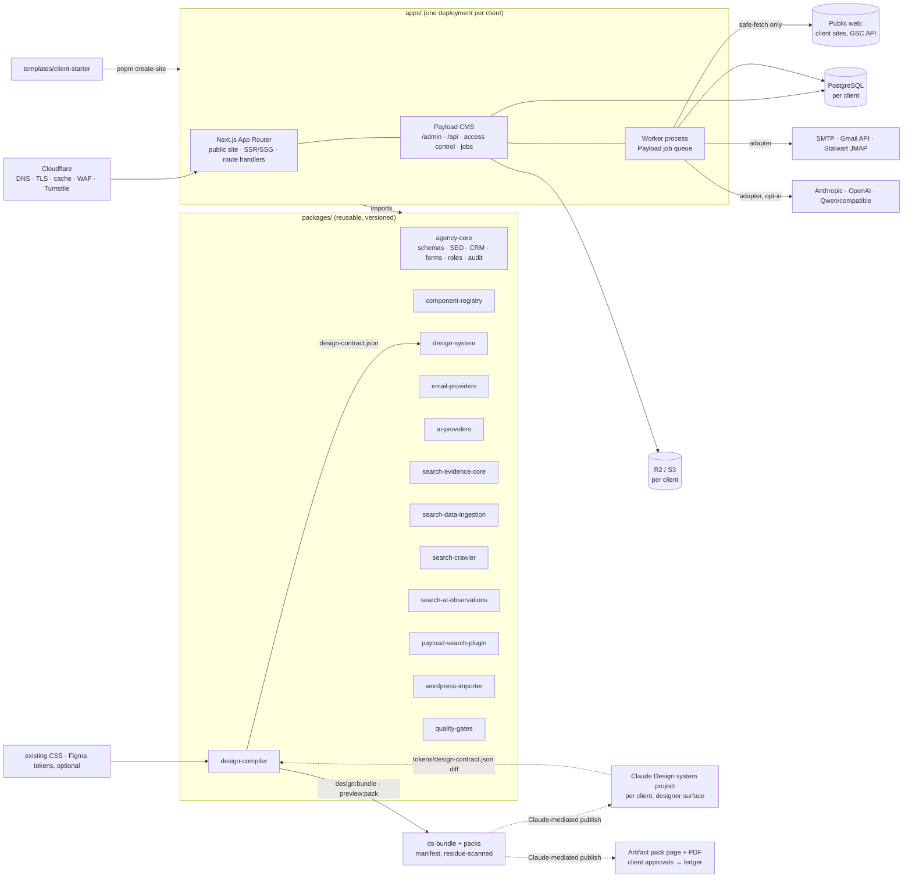

# Architecture

Milestone 0 proposal · 2026-09-03 · to be refined as milestones land. Decisions are recorded in `decision-log.md`.

## 1. Shape of the system

The diagram shows the **target** package set from the master prompt. Per ADR-003 the repository **starts** with `agency-core`, `design-contract`, `providers` and `quality-gates` (plus `apps/syed-ai` and `apps/search-evidence-local`) and splits packages only when a real second consumer appears; the boundaries below describe the responsibilities regardless of which physical package currently holds them. Search Intelligence has two editions (ADR-010): a local-first browser edition and an opt-in collaborative edition on PostgreSQL.

## 2. Boundaries

| Layer                                           | Owns                                                                                                                                                                                                                                                                                                                                                                                                                                                                                                                                                                                                                   | Must not                                                  |
| ----------------------------------------------- | ---------------------------------------------------------------------------------------------------------------------------------------------------------------------------------------------------------------------------------------------------------------------------------------------------------------------------------------------------------------------------------------------------------------------------------------------------------------------------------------------------------------------------------------------------------------------------------------------------------------------- | --------------------------------------------------------- |
| `apps/<client>`                                 | Brand, domains, fonts, imagery, copy, navigation, analytics ids, email identities, `design-contract.json`, `site-blueprint.json`, `.env`, Docker/Coolify config, seed data                                                                                                                                                                                                                                                                                                                                                                                                                                             | Contain reusable logic; import from `/legacy-reference`   |
| `packages/agency-core`                          | Payload collections and globals (Pages, Posts, People, taxonomies, CaseStudies, Testimonials, FAQs, GlossaryTerms, Citations, CTAs, Media, Navigation, Redirects, Forms, Submissions, Notices, SEO templates, Schema entities; CRM: Contacts, Companies, Leads, Pipelines, Activities, Tasks, Conversations, Messages, EmailTemplates, Consent, Suppression, LeadScoreRules), roles/access, audit log, SEO field group + JSON-LD builders, sitemap/robots/feeds/llms.txt generators, form pipeline (validate → anti-abuse → contact match → lead → activity → jobs), lead scoring, revalidation hooks, health endpoint | Know any client's brand or content                        |
| `packages/design-system`                        | Global CSS layer (reset, typography, rhythm, focus, motion), token CSS variables emitted by the compiler, primitives (Container, Stack, Prose, Button, Link, Table, Dl)                                                                                                                                                                                                                                                                                                                                                                                                                                                | Contain page-specific markup                              |
| `packages/design-compiler`                      | `design-contract.schema.json`, adapters (`from-css`; Release 3: `from-figma-tokens` optional, `from-claude-design` = diff of the project's `tokens/design-contract.json`), deterministic emitters (CSS vars, TS tokens, font-face, contrast report, **design-system bundle with manifest** — ADR-026)                                                                                                                                                                                                                                                                                                                  | Touch runtime                                             |
| `packages/component-registry`                   | Approved blocks: Payload block config + React component + fixture + tests + a11y notes; `/dev/blocks` preview route helper                                                                                                                                                                                                                                                                                                                                                                                                                                                                                             | Fetch data (blocks are pure render)                       |
| `packages/email-providers`                      | `EmailProvider` interface; `mock`, `smtp`, `gmail-api`, `stalwart`; threading headers; idempotency keys; bounce/complaint/suppression handling; sync cursors                                                                                                                                                                                                                                                                                                                                                                                                                                                           | Be called from the request path (jobs only)               |
| `packages/ai-providers`                         | `AIProvider` interface; `mock`, `anthropic`, `openai`, `openai-compatible`; gateway with budgets, permissions, redaction, prompt registry, structured output validation, provenance record (`generated`)                                                                                                                                                                                                                                                                                                                                                                                                               | Write to any scored field                                 |
| `packages/search-evidence-core`                 | Pure engines extracted from the suite: types, normalisation, CTR curve, gates, findings, actions, clustering, technical checks, health score, backlinks, internal links, briefs, media/schema/hreflang, SERP, AI eligibility/readiness/decisions, draft analysis, link profiles, snapshots/compare, report and workbook row builders; `SCORE_MODEL`, `RULES_VERSION`                                                                                                                                                                                                                                                   | Do I/O, read the clock, touch the DOM                     |
| `packages/search-data-ingestion`                | File readers (CSV/TSV/XLSX/ZIP/gz/JSON/ndjson), 12-language header classifier, column mapper, Semrush/Screaming Frog/Sitebulb adapters, GSC API client (engine + server-side PKCE OAuth), dataset persistence                                                                                                                                                                                                                                                                                                                                                                                                          | Score anything                                            |
| `packages/search-crawler`                       | `safeFetch` (SSRF guard), robots/sitemap parsing, BFS crawler with budgets, `extractPage` port (linkedom), link graph, minhash near-dupes, HTML→markdown import                                                                                                                                                                                                                                                                                                                                                                                                                                                        | Fetch anything outside a project's verified scope         |
| `packages/search-ai-observations`               | AI-Overview/answer-engine observation model and recorder, citation context/packs, AI-agent access model, GEO evidence table, prompt-pack modules                                                                                                                                                                                                                                                                                                                                                                                                                                                                       | Average recorded observations with observed/reported data |
| `packages/payload-search-plugin`                | Collections (SearchProjects, DataConnections, ImportedDatasets, CrawlRuns, CrawledPages, SearchMetrics, PageAudits, TopicClusters, Competitors, AISearchObservations, AuditRuns, Recommendations, ContentBriefs, DraftAnalyses, Snapshots, SearchReports), jobs, admin views, link-by-canonical to Pages/Posts, pre-launch parity comparison                                                                                                                                                                                                                                                                           | Bypass the core engines                                   |
| `packages/wordpress-importer`                   | WXR + REST readers, Rank Math/Yoast/ACF/Elementor mappers, media fetch, redirect map, dry-run and idempotent upsert by `wp:post_id`, migration report, crawl baseline + parity report                                                                                                                                                                                                                                                                                                                                                                                                                                  | Emit Elementor wrapper markup                             |
| `packages/quality-gates`                        | Launch-blocking vs advisory rule sets, metadata/canonical/robots/sitemap/schema/redirect/status checks, legacy-string and secret scans, Lighthouse thresholds, machine-readable report                                                                                                                                                                                                                                                                                                                                                                                                                                 | —                                                         |
| `templates/client-starter`, `tools/create-site` | Interactive scaffold producing an isolated `apps/<client>`, `.env.example`, Compose/Coolify template, blueprint, seeds, launch checklist; leak scan for Syed AI strings                                                                                                                                                                                                                                                                                                                                                                                                                                                | Copy any Syed AI brand, content, ids or secrets           |

## 3. Request and job paths

**Public page.** Cloudflare → Next.js server component → Payload local API (no HTTP hop) → HTML with content, metadata and JSON-LD in the initial response. Revalidation tags per collection/document, purged on publish. No client JavaScript is needed for content; interactive blocks (simulator, scorecard, revenue model, chat, palette) hydrate progressively.

**Form submission.** Route handler → zod → honeypot/dwell/Turnstile/rate-limit (Postgres) → spam score → dedupe → `Contacts` match by normalised email → `Leads` create with source/UTM/consent → `Activities` immutable event → enqueue `notify-owner`, `send-confirmation`, `roadmap-scan`, `crm.sync` jobs → respond (JSON or HTML). Worker executes jobs through `EmailProvider`/`CrmProvider`/`safeFetch` with idempotency keys. `crm.sync` pushes the allow-listed lead facts to the client's CRM (webhook/HubSpot/Pipedrive) and records `externalRefs`; the visitor never waits on it (`docs/crm-sync.md`).

**Search Intelligence run.** Import job (`search-data-ingestion`) → normalised datasets in Postgres → audit job (`search-evidence-core`) → `AuditRuns` with `SCORE_MODEL`, `RULES_VERSION`, `computedAt` → `Recommendations` linked to Pages/Posts by canonical → editor accepts/rejects/assigns → optional AI brief (`generated`, never scored) → publish (human) → recrawl job → `Snapshots` compare.

## 4. Security boundaries

Roles: platform-admin, client-admin, editor, search-analyst, sales, viewer. CRM, search and email actions are separately scoped from content editing. All secrets via environment; OAuth refresh tokens and provider keys encrypted at rest with a per-client key. Health endpoint reports component status booleans only. No proxy endpoint, no diagnostic routes. Audit log on sign-in, permission change, publish, redirect, CRM change, AI call, email send, import, config change.

**Key custody (ADR-023, from R28/R29).** Three kinds of key exist per client and are never the same value: the application encryption key (provider tokens at rest), the backup key (`age` recipient for `pg_dump` archives) and provider credentials. Rules: keys are generated offline on an operator machine, never in a browser or a ticket; each is stored in the agency password manager **and** as an offline copy the client can be given at offboarding (R40); backup private keys are never present on the server that makes the backups; rotation is a runbook with a restore-with-new-key drill, not a note; client-hosted servers receive secrets as `sops`/`age`-encrypted files committed to the client's private ops repo, Coolify-hosted ones through the Coolify env store. A lost backup key is treated as data loss and drilled as such.

**Turnstile (R38).** Enabled at launch. Site key in the `integrations` global, secret in the environment; half-configured pairs fail closed (`turnstileReadiness()`), production without a pair blocks the launch gate.

**Search Suite code stays in this monorepo (A11, ADR-023).** No `search-*` package ships in a client starter, `create-site` output or client image until the owner sets distribution terms.

**No email on public surfaces (ADR-028).** No email address appears in public HTML, JSON-LD, `llms.txt`, the sitemap, error pages, or any anonymously readable REST global or collection; contact runs through forms. The single exception is the `privacy` page, which may show one alias mailbox created for the purpose (`contact-legal.privacyContactAlias`), never a person's or an admin's. The `no-public-email` gate, a `schema-entities` hook, masked confirmation pages, the importer's `mailto:` stripping and the residue scanner's email rule enforce it; audit rows store actor id and role, not email.

**OGCS boundary (ADR-028).** The owner's control system is a separate deployment. It reaches a client site in two ways only: structural changes as `page-decisions` artefacts that become a blueprint PR, and content changes as **drafts** written by a `service-accounts` identity with the single role `automation`, scoped to `pages`, `posts`, `media`; hooks make publishing, verifying, deleting, slug/parent changes and locked-SEO edits impossible for it. Humans bulk-approve in the Automation review view. OGCS holds one API key per client and nothing else from the Factory.

## 5. Deployment

Docker images for `web` and `worker` from one build; Compose for local (Postgres + MinIO); Coolify on a VPS per client with Cloudflare in front (DNS, TLS, cache rules bypassing `/admin`, `/api`, form routes; WAF; Turnstile). R2 for media in production. Backups: nightly `pg_dump` → `age` → `rclone` to R2 with object versioning; weekly automated restore test; alert when the newest backup is older than 26 h; restore drill documented in `backup-restore.md` (Release 7).

**Client-hosted path.** The same two images run on a server the client controls: they receive the images (or a build from their private fork of the client app), an `age`-encrypted secrets file, the Compose file and the runbooks; we keep no shell access after handover unless contracted. Upgrades ship as a new image tag plus a migration; rollback is the previous tag plus the pre-migration backup. The residue scan and the `search-*` exclusion run on every image built for a client.

**Launch is reversible.** The legacy host stays live until the staged site passes crawl parity and a restore has been proven; DNS cutover is the last step and the rollback is a DNS change. Migrations from a live source (WordPress) use a freeze window and a delta import (R44).
