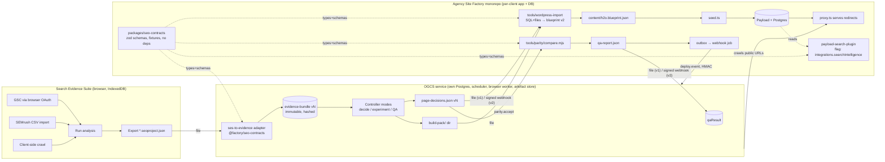

# AGENCY_SITE_FACTORY_INTEGRATION_DECISION

**Version:** 1.1 (amended)
**Question answered:** `00_START_HERE/AGENCY_SITE_FACTORY_ARCHITECTURE_QUESTION.md` — should OGCS + Search Evidence be embedded inside the Agency Site Factory, remain a separate connected service, or use a hybrid plugin/SDK architecture?

**Basis:** code-level inspection of the Agency Site Factory repo (`~/Projects/agency-site-factory-workspace/agency-site-factory`, HEAD `88f5469`, 25 ADRs), the OGCS Build Package v1 (spec, JSON Schema, playbook), the Search Evidence Suite source (`search-evidence-console`, 12.3k-line `app.js`, `proxy.php`), and the H2O Payload Migration Discovery Pack v1. Every claim about the Factory below cites a file path.

> **Amendment v1.1 (2026-09-05, after owner clarification).** The owner confirmed OGCS is his *own* control system — not a product distributed to clients — and that its job includes pushing his changes for client sites live. This strengthens the "separate service" conclusion (OGCS is agency-wide state; the Factory is per-client isolation) and relaxes one rule: instead of "OGCS never holds Payload credentials", OGCS holds **one scoped, revocable API key per client** belonging to a `service-accounts` document with the single role `automation`, used for *content* edits (Lane B). *Structural* changes (URLs, redirects, IA, PRUNE/CONSOLIDATE/NOINDEX) still go through `page-decisions` → blueprint → parity gate (Lane A). The full model is in `publishing-lanes.md`; the ADR text is `ADR-026`. Wherever this document says OGCS "never holds Payload credentials" or "never writes to Payload", read it as "never holds database/`PAYLOAD_SECRET`/S3 credentials, and writes only through the `automation` service account within Lane B limits."

---

## 0. Recommendation in one paragraph

**Hybrid — but a specific hybrid: OGCS runs as a separate service with its own database and deploy; Search Evidence Suite stays an independent, browser-first product; the Factory gains one dependency-free contracts package and one optional, feature-flagged Payload plugin; and every connector is a versioned file artefact first, with HTTP/webhooks added later behind flags.** Embedding OGCS into the Factory monorepo is rejected because OGCS is an agency-wide portfolio controller and the Factory is deliberately one-process-one-database-per-client (ADR-004, ADR-005) with exact version pinning enforced in CI (`tools/scripts/check-versions.mjs`) — putting a cross-client brain inside a per-client image contradicts the Factory's core isolation invariant and multiplies its blast radius. A purely separate OGCS with ad-hoc connectors is rejected because the Factory already has the right seams (a blueprint that ADR-025 names as "the seam", a parity gate that accepts declared exceptions, an outbox/idempotency pattern, a `searchIntelligence` flag and `SEARCH_USERS` role that exist and are unused) and leaving them unused would mean re-inventing them outside the repo with no contract tests. The hybrid uses those seams and nothing more.

---

## 1. What the code actually constrains

These are the facts that decide the answer. They are not assumptions.

**Factory**

1. One Next.js + Payload process, one Postgres, one S3 bucket, one secret set *per client site*; no `clientId`, no multi-tenancy (`docs/decision-log.md` ADR-004, ADR-005; `apps/syed-ai/payload.config.ts`).
2. Jobs run only in a separate worker polling Payload's Postgres-backed queue; no Redis (ADR-004, ADR-017; `apps/syed-ai/src/worker.ts`). Exactly one task exists, and it demonstrates the intended idempotency pattern: unique `outbox.idempotencyKey` + find-before-create (`src/jobs/sendMockEmail.ts`, `packages/agency-core/src/cms/collections/operations.ts`).
3. Content enters Payload through exactly one ingress: a JSON **blueprint** (`apps/syed-ai/content/syed-ai.blueprint.json`, `version: 1`) produced by an extractor (`tools/legacy-extract/`) and consumed by an idempotent seed (`src/seed.ts`). ADR-025 states WordPress and copy-deck importers will also emit blueprints. **The blueprint has no schema validator** — unlike `design-contract.json`, which is zod-validated with per-value provenance (`packages/design-contract/src/schema.ts`).
4. The Factory's only working external-adapter pattern is the design contract: N adapters → one versioned intermediate JSON with `{value, source:{kind, ref}}` provenance → deterministic emitters → CI reproducibility diff (`packages/design-contract/`, ADR-006, ADR-020). This is the house style for integration.
5. QA is a **parity gate** (`tools/parity/compare.mjs`) that fetches each route JS-off and compares status, title, description, canonical, robots, OG/Twitter, single H1, JSON-LD `@type` multiset and `@id` set, anchors and internal-link removals against a frozen baseline (`docs/baselines/seo-baseline.json`), with `blueprint.parity.accept` as the declared-exception input and exit code 1 as the block. Plus Playwright e2e and a 55-cell role×collection threat-model test suite on a real Postgres (`apps/syed-ai/test/threat-model.test.ts`). CI order is fixed in `.github/workflows/ci.yml`.
6. The Factory already contains **pre-cut, unused seams for search intelligence**: `SEARCH_USERS` role group and `searchRead` accessor (`packages/agency-core/src/cms/access/roles.ts`), `integrations.searchIntelligence.enabled = false` (`cms/globals/index.ts`), a "Search Intelligence run" job path in `docs/architecture.md §3`, and target packages `search-evidence-core / search-data-ingestion / search-crawler / search-ai-observations / payload-search-plugin` in `docs/architecture.md §2`.
7. ADR-023: **no `search-*` package ships in starter or client images until the owner sets licensing terms.** ADR-010: Search Evidence is to be *characterised then extracted*, with `tools/baseline/ses-characterize.mjs` producing 27 deterministic fixtures (`docs/baselines/ses-fixtures/`) that any extracted engine must reproduce to 1e-9; "local-first stays a product mode".
8. `packages/agency-core` is one unit — `cms/collections/core.ts` imports `blocks/payload`. A contracts-only package must therefore **not** depend on `agency-core`, or it drags React/blocks into whatever consumes it.
9. Gaps that matter for H2O specifically: the `redirects` collection is written by the slug hook but **never read at request time** (`src/proxy.ts` hard-codes rules) and `seed.ts` does not seed the blueprint's `redirects[]`; there is no WordPress importer; `verification.status` is stored but not enforced; `quality-gates` contains only the residue scanner, not the SEO gates the docs describe.

**OGCS**

10. Spec-only. No code, no HTTP API, no event or queue contract. Two file contracts in prose: inbound `ogcs-evidence.json` (unschematised), outbound **AI Build Pack** (directory of CSV/JSON/MD, unschematised). Needs Postgres, a job queue, a browser worker, a scheduler, an artefact store. Single-project JSON Schema root with `daily_state.projects[]` implying portfolio scope. Stores access *state*, never credentials (`accessRecord`).
11. QA in OGCS is defined as inspecting *real staging/live URLs* — it needs to crawl what the Factory deploys, not read the Factory's database.

**Search Evidence Suite**

12. Static browser app, all state in IndexedDB (`seo-suite` v2), GSC via browser-side OAuth token that cannot be reused server-side, exports only via browser download: `*.seoproject.json` (format `search-evidence-console/project` v1 — the only export with raw rows and crawl pages), `*-snapshot-*.json` (`search-evidence-suite/snapshot` v1), 7-sheet XLSX, CSV zip, HTML. **No API, no `ogcs-evidence.json` export exists** (`ogcs` appears 0 times in `app.js`). `X-Frame-Options: DENY` prevents embedding it in another UI. `proxy.php` is a fetch relay, not an integration surface.

---

## 2. The three options, scored

Scale 1 (poor) – 5 (excellent). Scores reflect *this* codebase and *these* two systems as they exist today, not the options in the abstract.

| Criterion | A. Embedded in monorepo | B. Separate OGCS service + connectors | C. Hybrid: separate service + contracts pkg + flagged plugin |
|---|:-:|:-:|:-:|
| Reliability | 2 — OGCS scheduler/crawler failures share a process and DB with client sites | 4 — isolated; but ad-hoc connectors are the weak link | **5** — isolated, and connectors are contract-tested against fixtures in Factory CI |
| Coupling | 1 — OGCS would import `agency-core`, pin Payload `^3.88`, and every OGCS collection becomes a migration in every client app (`push:false`) | 4 — coupled only at connector edges | **5** — coupled only to `@factory/seo-contracts` (zero runtime deps) |
| Bug blast radius | 1 — an OGCS bug can take down a client's site or corrupt its DB; violates ADR-005 | 4 — bug stays in OGCS; connector bugs limited to one artefact | **5** — plugin is flag-off by default (ADR-023), so worst case is a rejected file |
| Development speed (first 8 weeks) | 3 — no new repo, but must clear Factory CI (threat-model matrix, versions check, residue scan) for every OGCS table | 4 — free to move fast in OGCS; slowed by connector re-invention | **4** — fast in OGCS; contracts package is small; plugin can wait |
| Ease of local Claude Code development | 3 — one `pnpm dev`, but Postgres now has ~55 collections and the admin bundle grows | 4 — two repos, two dev loops | **4** — two repos, but shared fixtures (`ses-fixtures/`, blueprint) make each loop testable offline |
| Reusability across client sites | 2 — every client image carries OGCS code it must not ship (ADR-023) | 4 — OGCS serves all clients naturally | **5** — OGCS serves all clients; per-client only the plugin toggle changes |
| Ability to replace one subsystem later | 1 — OGCS tables intertwined with Payload migrations; Search Evidence engine extraction (ADR-010) forced into Payload's schema | 4 — replaceable if contracts were written down; they usually aren't | **5** — contracts are versioned files with golden fixtures; swap either side |
| Payload compatibility | 3 — works, but Payload major upgrades now block on OGCS code too | 5 — Payload untouched | **4** — plugin follows Payload's plugin API and the peer-pin policy |
| Search Evidence independence | 1 — would force IndexedDB/browser app into a server model, breaking "local-first stays a product mode" (ADR-010) | 5 — untouched | **5** — untouched; adapter consumes its existing exports |
| Observability / debuggability | 3 — all in one log, but which system caused a failure is unclear | 4 — separate logs; cross-system tracing needs correlation IDs | **5** — every artefact carries `run_id`, `source_hash`, `contract_version`; Factory keeps the same idempotency-key discipline as `outbox` |
| Security / secrets isolation | 1 — GSC/SEMrush/AI keys live in a client's image; contradicts "secrets only in env, public identifiers in `integrations`" | 5 — each system has its own secret set | **5** — same; the plugin has no secrets (files in, files out) |
| Data consistency | 2 — one DB *seems* consistent but OGCS decisions and Payload content have different lifecycles; migrations become a shared-schema nightmare | 3 — eventual, and without a contract you get silent drift | **4** — eventual by design; hashes + `page_decisions` versioning + parity gate make drift *visible and blocking* |
| Deployment complexity | 3 — one deploy, but OGCS scheduler/browser worker are heavyweight for every client | 3 — two deploys | **4** — two deploys, but the Factory side is a no-op until the flag is on |
| **Total (65)** | **26** | **53** | **60** |

The margin between B and C is entirely the contracts package and the fixture-tested adapters. That is what makes C worth the extra package.

---

## 3. The recommended architecture

### 3.1 Systems and ownership

| Concern | Owner (system of record) | Where it physically lives | Others hold |
|---|---|---|---|
| **Raw SEO measurement** (GSC rows, SEMrush rows, crawl pages, runs) | Search Evidence Suite | Browser IndexedDB → exported `*.seoproject.json` | OGCS keeps the *immutable file* + SHA-256 in its artefact store; Factory keeps only the hash reference in `page_decisions` |
| **Normalised evidence** (`evidence-bundle`) | OGCS (derived artefact) | OGCS artefact store, versioned by `run_id` | Factory: none |
| **Project state** — goals, constraint, health, SEO decisions, SERP observations, experiments, tactics, tasks, workers, access state, daily state | OGCS | OGCS Postgres (its own schema per `ogcs_core_data_schema_v1.json`) | Factory: none; the Payload `integrations.searchIntelligence` group stores only `ogcsProjectId` (public identifier) |
| **Build specification** — what pages exist, their URLs, blocks, SEO fields, redirects, media, schema entities | **Factory repo (git)** as `blueprint.json` v1 → v2 | `apps/<client>/content/<client>.blueprint.json`, committed | OGCS holds the *page decisions* that produced it and the blueprint's hash |
| **Page decisions** (PROTECT/IMPROVE/…/PRUNE, target URLs, `seo_lock`, `prune_blocked`, approver) | OGCS | OGCS DB + emitted `page-decisions.json` file | Factory consumes it into the blueprint and into `parity.accept`; never edits it |
| **Payload execution** — live content, media, redirects, drafts, audit log, forms/CRM | Factory / Payload | Per-client Postgres + S3 (ADR-005) | OGCS reads only public URLs and QA reports |
| **QA results** (parity report, e2e results, Lighthouse) | Factory CI *produces*; OGCS *records* | Raw report in CI artefacts + committed `qa-report.json`; OGCS stores `qaResult` referencing it | Factory does not interpret QA results strategically |
| **Redirect map** | Blueprint `redirects[]` (Factory) | Seeded into Payload `redirects` collection; served by `proxy.ts` (to be fixed) | OGCS proposes it in `page-decisions` |
| **Secrets** | Each system for itself | env only; never in artefacts | — |

Rule of thumb: **OGCS owns decisions; Search Evidence owns measurements; the Factory owns what is built and what is live. Files are the only thing that crosses a boundary in v1.**

### 3.2 Diagram



### 3.3 Components to add (and nothing else)

**In the Factory monorepo**

| Package / tool | Purpose | Dependencies | Ships in client image? |
|---|---|---|---|
| `packages/seo-contracts` (`@factory/seo-contracts`) | zod schemas + TS types + golden fixtures for `blueprint` v2, `evidence-bundle`, `page-decisions`, `qa-report`, `deploy-event`; a `validate` CLI. Modelled on `packages/design-contract/src/schema.ts`. | `zod` only. **Must not import `agency-core`.** | Yes (types only; no secrets, no `search-*` engine code — ADR-023 compliant) |
| `tools/wordpress-import` | WordPress SQL + files archive → blueprint v2, applying `page-decisions.json` (PRUNE never emitted as a page; REDIRECT → `redirects[]`; provenance → `pages[].migration`). Sibling of `tools/legacy-extract`. | Node, `mysql2`-free SQL parsing or a throwaway Postgres/MySQL container; `@factory/seo-contracts` | No (tooling) |
| `packages/payload-search-plugin` (optional, later) | Payload plugin adding read-mostly collections `seo-evidence-refs`, `page-decisions`, `qa-reports` (references + hashes, not raw rows), an admin side-panel showing the current decision/evidence hint for the page being edited, and the `searchRead` access already defined. Registered in `payload.config.ts` only when `integrations.searchIntelligence.enabled`. | `payload` peer `^3.88`, `@factory/seo-contracts` | Only when the flag is on; excluded from starters by default |
| Changes to `agency-core` | (a) add a `migration` field group to `pages` (`sourceUrl, sourceId, originalTitle, originalH1, originalWordCount, originalHtmlHash, importedAt, seoLocked, finalMigrationAction, decisionsVersion`) — the discovery pack's `CANDIDATE_CONTENT_MODEL.md` provenance list, which Pages currently lacks; (b) new job task `emitWebhook` using the exact `sendMockEmail` idempotency pattern; (c) `proxy.ts` reads `redirects` (see §6 prerequisites) | none new | Yes — these are generic Factory improvements H2O needs anyway |

**Outside the Factory**

| Component | Purpose |
|---|---|
| OGCS service (separate repository `ogcs/`, Node/TypeScript recommended to share `@factory/seo-contracts` as an npm dependency) | Sprint 1–10 of `OGCS_NEXT_BUILD_STEPS_v1.md`, unchanged, plus the two adapters below |
| `ses-to-evidence` adapter (CLI inside OGCS, or a `pnpm` script in the Factory's `tools/` for local runs) | Reads `*.seoproject.json` (`search-evidence-console/project` v1) and optionally `*-snapshot-*.json`; emits `evidence-bundle` vN. Tested against `docs/baselines/ses-fixtures/` |
| Search Evidence Suite | Unchanged in v1. Optional v2 change: add "Export → OGCS evidence bundle" in `05l-export.js` so the adapter becomes a no-op |

---

## 4. Connector contracts (minimal, versioned)

All five artefacts share an envelope. All are **files first**; §4.6 says how the same payloads later travel over HTTP.

```jsonc
// Common envelope — every artefact
{
  "contract": "factory.seo/<name>",     // e.g. factory.seo/evidence-bundle
  "contract_version": "1.0.0",           // semver; MAJOR = breaking
  "produced_by": { "system": "ogcs|ses-adapter|factory-ci|wordpress-import", "version": "…" },
  "produced_at": "2026-09-05T16:00:00Z",
  "project_id": "h2o-cooling",           // OGCS project_id; Factory stores it in integrations.searchIntelligence.ogcsProjectId
  "run_id": "01J…",                      // ULID; idempotency key across systems
  "inputs": [ { "artefact": "…", "sha256": "…" } ],   // provenance chain
  "payload": { … }
}
```

### 4.1 `factory.seo/evidence-bundle` — Search Evidence → OGCS

Produced by `ses-to-evidence`. Direction: SES export file → OGCS artefact store. Immutable.

```jsonc
"payload": {
  "source_format": "search-evidence-console/project",  "source_version": 1,
  "measurement_window": { "start": "2025-05-01", "end": "2026-09-03", "basis": "gsc_api|gsc_ui|semrush|crawl" },
  "coverage": { "gsc": true, "semrush_positions": true, "semrush_backlinks": true, "crawl": true, "surfer": false, "ai_observations": 3 },
  "pages": [ {
      "url": "https://h2ocooling.com/…/", "canonicalized_url": "…",
      "gsc":   { "clicks": 12, "impressions": 890, "ctr": 0.013, "position": 14.2, "provenance": "measured" },
      "backlinks": { "referring_domains": 3, "backlinks": 7, "follow_ratio": 0.71, "provenance": "imported" },
      "crawl": { "status": 200, "title": "…", "h1": "…", "word_count": 812, "internal_inlinks": 9, "schema_types": ["WebPage"], "hreflang": [], "provenance": "measured" },
      "surfer": null,                                   // null = not measured, never 0
      "ai_visibility": { "mentioned": 0, "cited": 0, "provenance": "recorded" }
  } ],
  "queries": [ … ],  "page_query_ownership": [ … ],
  "findings": { "cannibalization": [ … ], "decay": [ … ], "striking_distance": [ … ], "technical": [ … ] },   // straight from SES findings-*.json shapes
  "action_queue": [ { "rank": 1, "decision": "…", "target": "…", "impact": "…", "effort": "…", "basis": "…", "evidence": [ … ] } ],
  "run_history_reference": { "ses_run_id": "…", "score_model": 2, "overall": 71 }
}
```

Rules: `null` means unmeasured (matches SES); every numeric carries `provenance ∈ {measured, imported, recorded, estimated, generated, unknown}` (matches OGCS §8 + NEXT_BUILD_STEPS). This is the `ogcs-evidence.json` the OGCS spec asks for, with a schema.

### 4.2 `factory.seo/page-decisions` — OGCS → Factory

The single most important contract. It is the discovery pack's `URL_MASTER.csv` + `PAGE_DECISIONS.csv` + `REDIRECT_MAP.csv` as one validated document.

```jsonc
"payload": {
  "site": { "source_origin": "https://h2ocooling.com", "target_origin": "https://h2ocooling.com" },
  "decisions_status": "draft|approved",
  "approved_by": "syed", "approved_at": "…",           // required when approved
  "evidence_bundle_sha256": "…",                      // must match an input
  "pages": [ {
      "source_url": "https://h2ocooling.com/blog/home-cooling-tips/",
      "action": "PROTECT|IMPROVE|REWRITE|REPOSITION|CONSOLIDATE|REDIRECT|NOINDEX|PRUNE|REVIEW",
      "target_url": null,                              // required for REDIRECT/CONSOLIDATE
      "status_code": 301,                              // for REDIRECT
      "page_type": "article", "project_scale_fit": "consumer",
      "strategic_fit_score": 4, "seo_equity_score": 0,
      "seo_lock": false, "prune_blocked": false,
      "reason": "…", "why_should_this_exist": "…",
      "collection_hint": "posts|pages|services|projects|parts|part-categories|…",
      "parity": { "accept": ["title", "h1"], "word_count_blocking": false }   // feeds compare.mjs
  } ],
  "redirects": [ { "from": "/blog/home-cooling-tips/", "to": "/resources/…/", "status": 301, "reason": "…", "source": "migration" } ],
  "information_architecture": { "collections": [ … ], "nav": [ … ] }          // optional, from Build Pack
}
```

Invariants enforced by the zod schema and by `tools/wordpress-import`: `PRUNE` with `prune_blocked=true` is a validation error; `REDIRECT` without `target_url` is an error; `decisions_status != approved` → importer refuses to emit `PRUNE`, `REDIRECT` or `NOINDEX` (they degrade to `REVIEW` and the page is imported as a draft). This is the "required evidence/approval gate" from the master prompt, encoded.

### 4.3 `factory.seo/blueprint` v2 — Factory-internal, but OGCS may produce it

Existing blueprint v1 (`syed-ai.blueprint.json`) plus: a zod schema; `pages[].migration` provenance group; `pages[].decision_ref` (`run_id` + `source_url`); `parity` block made explicit; `redirects[]` actually seeded. The OGCS **AI Build Pack** is *not* consumed directly by the Factory — the importer/build step turns Build Pack + page-decisions into a blueprint, so the Factory has one ingress, as ADR-025 intends.

### 4.4 `factory.seo/qa-report` — Factory CI → OGCS

Emitted by `tools/parity/compare.mjs` (which already writes a JSON report) wrapped in the envelope, plus Playwright summary and Lighthouse if run.

```jsonc
"payload": {
  "environment": "staging|production", "base_url": "https://staging.h2ocooling.com",
  "baseline": { "kind": "frozen-old-site|approved-staging", "sha256": "…" },
  "blueprint_sha256": "…", "page_decisions_run_id": "…",
  "result": "pass|fail",
  "blocking": [ { "url": "…", "check": "canonical|title|h1|status|redirect|schema_type|schema_id|internal_link|noindex", "expected": "…", "actual": "…" } ],
  "advisory": [ … ],
  "coverage": { "routes_checked": 412, "routes_in_decisions": 412, "protect_urls_missing": 0 }
}
```

### 4.5 `factory.seo/deploy-event` — Factory → OGCS

Small. `{ "environment", "base_url", "blueprint_sha256", "git_sha", "migrations_applied": [...], "status": "deployed|rolled_back" }`. Lets OGCS start post-launch monitoring (spec Phase 11) without polling.

### 4.6 Transport: files in v1, HTTP in v2, same payloads

- **v1 (H2O pilot):** artefacts are committed to a `handoff/` directory in the client app (`apps/h2o-cooling/handoff/{evidence,decisions,qa}/<run_id>.json`) or exchanged via the OGCS artefact store. Git is the queue. Idempotency = `run_id` + content hash.
- **v2:** OGCS exposes `POST /v1/projects/{id}/qa-reports` and `/deploy-events`; the Factory posts via a new `emitWebhook` job (outbox row keyed `ogcs:<kind>:<run_id>`, HMAC-SHA256 signature using the same scheme `docs/crm-sync.md` already designs for the generic CRM webhook, retries 1m/5m/30m/2h/12h, dead-letter to an `activities`-style record). OGCS exposes `GET /v1/projects/{id}/page-decisions/latest` for the importer. Contracts unchanged — only transport.
- **Lane B (v1.1):** OGCS → Payload REST with the per-client `automation` service-account key for content-only edits; see `publishing-lanes.md`.
- **Never:** shared database, shared Redis, Payload local API called from OGCS, OGCS tables in a client's Postgres, OGCS holding `DATABASE_URI`/`PAYLOAD_SECRET`/S3 keys.

---

## 5. How H2O flows end-to-end through this architecture

1. **Intake (now).** Hostinger archives + DBs for OLD and NEW land in the handoff folders. GSC/SEMrush/Surfer exports collected; Search Evidence Suite H2O project built (GSC connector, SEMrush CSVs, crawl) and exported as `*.seoproject.json`.
2. **Freeze.** Discovery-pack crawler (`h2o_freeze_crawl.py`) runs from the Mac against live `h2ocooling.com` and against both extracted archives served locally (PHP built-in server or WordPress in Docker) → raw HTML, `URL_MASTER.csv`, `CONTENT_TRIAGE.csv`, `MEDIA_MASTER.csv`, `INTERNAL_LINK_GRAPH.csv`, `SCHEMA_MASTER.json`, `claude-pages/`. The Factory's `tools/baseline/capture-baseline.mjs` also captures `seo-baseline.json` + screenshots of the **OLD** site — this becomes the parity baseline.
3. **Evidence.** `ses-to-evidence` turns the SES export into `evidence-bundle` run `R1`. GSC/SEMrush CSVs that bypassed SES are merged with the discovery pack's `merge_search_evidence.py` logic folded into the adapter. Stored in the OGCS artefact store; hash recorded.
4. **Decide (OGCS, human-in-the-loop).** OGCS (initially: Claude operating the OGCS controller prompt against the bundle + triage, before the service exists) produces `page-decisions` `R1` in `draft`. Every URL gets strategic fit and SEO equity separately. Off-topic copywriter posts with zero clicks and zero referring domains become `PRUNE` candidates; those with equity become `REPOSITION`/`REDIRECT`/`CONSOLIDATE`; all `REVIEW` items are answered by Syed. Approval flips `decisions_status` to `approved` with `approved_by`. IA and Payload collections (Services, Projects, Parts, Part Categories, Articles, Locations, Authors, Media, Redirects…) are fixed in the same document.
5. **Build spec (Factory).** `tools/wordpress-import` reads the OLD (or NEW, per decision) SQL + uploads + `page-decisions R1` → `apps/h2o-cooling/content/h2o-cooling.blueprint.json` (v2, validated). PRUNE pages are never emitted; their raw source stays in the frozen archive. Each page carries `migration.*` provenance. `redirects[]` holds the approved 301 map. Blueprint committed; hash recorded.
6. **Execute (Payload).** `seed.ts` upserts into the H2O app's own Postgres (new `apps/h2o-cooling`, created from `apps/syed-ai` until `tools/create-site` exists). Redirects are seeded and served by `proxy.ts`. Media uploaded to the H2O bucket with alt/rights. Staging deployed.
7. **QA (Factory CI → OGCS).** `compare.mjs` runs staging against the OLD-site baseline with `parity.accept` from decisions → `qa-report` `R1`. Playwright: single-hop 301s, no chains, no accidental noindex on PROTECT URLs, sitemap coverage, schema `@id` continuity. Threat-model tests pass on the new collections. Report goes to OGCS as `qaResult`; OGCS's own browser worker performs QA pass A/B/C on staging URLs.
8. **Launch gate.** Blocked unless `qa-report.result = pass`, `protect_urls_missing = 0`, `verification.status = verified` for every published page (enforcement to be added to `quality-gates`), and `decisions_status = approved`. Then `deploy-event` → OGCS starts Phase 11 monitoring.
9. **Continuous loop.** Weekly: new SES export → `evidence-bundle R2` → OGCS experiments → `page-decisions R2` (deltas only) → importer emits blueprint diff → seed → parity vs *approved staging* baseline → `qa-report R2`. The Factory never sees OGCS internals; OGCS never writes to Payload.

---

## 6. Risk assessment — will this integration introduce bugs, coupling, deploy failures or regressions?

Honest answer: **the integration itself is low-risk because nothing crosses the boundary except validated files; the risk is concentrated in four pre-existing Factory gaps that H2O will hit regardless of architecture.** Fix those first.

### 6.1 Prerequisites in the Factory (independent of OGCS)

| # | Gap (file) | Why H2O breaks without it | Fix |
|---|---|---|---|
| P1 | `redirects` never served (`apps/syed-ai/src/proxy.ts`); blueprint `redirects[]` not seeded (`src/seed.ts`) | A WordPress migration's SEO equity lives in its 301 map. Today it would silently 404. | `proxy.ts` loads `redirects` (cached, revalidated on change via existing `makeRevalidateAfterChange`); `seed.ts` upserts `redirects[]` by `from`. Add e2e: every `page-decisions.redirects[]` row resolves in one hop. |
| P2 | Blueprint has no validator | Two producers (legacy-extract, wordpress-import) + OGCS → silent shape drift | `packages/seo-contracts` zod schema for blueprint v2; `seed.ts` validates before touching the DB; CI validates committed blueprints |
| P3 | No `migration` provenance on `pages` | Can't trace a live page to its source URL/decision; can't audit PRUNE | Field group in `agency-core/cms/fields`, admin-only, populated by seed |
| P4 | `verification.status` not enforced; `quality-gates` has only the residue scanner | Launch gate is documentation, not code | `quality-gates` gains `seo-launch-gate`: fails on unverified published pages, PROTECT URLs missing from sitemap, `noindex` on `seo_lock` pages |
| P5 | No WordPress importer | Obvious | `tools/wordpress-import` (SQL: `wp_posts`, `wp_postmeta` for Yoast/RankMath `_yoast_wpseo_*`/`rank_math_*`, `wp_terms`, `wp_term_relationships`, WooCommerce `_product_*` meta, menus; files: `uploads/`) |

### 6.2 Integration risks and mitigations

| Risk | Likelihood / impact | Mitigation built into the design |
|---|---|---|
| **Contract drift** between OGCS output and importer input | High if unmanaged | Semver `contract_version`; golden fixtures for every contract in `packages/seo-contracts/fixtures/`; importer refuses unknown MAJOR; both repos run the same `validate` CLI in CI |
| **Silent evidence corruption** (e.g. 0 vs null, UI-export truncation treated as complete) | Medium / high (wrong PRUNE) | `null`-means-unmeasured enforced by schema; `coverage` block mandatory; importer sets `prune_blocked=true` when `coverage.gsc=false` regardless of scores |
| **Version-pin conflict** (`versions:check` fails when plugin bumps a dep) | Medium / low | Plugin peer-pins `payload ^3.88` like `agency-core`; `seo-contracts` depends only on `zod` (already pinned by `design-contract`) |
| **Threat-model regression** when plugin adds collections | Medium / medium | `docs/threat-model.md §Maintenance` rule: new collections join `SENSITIVE_COLLECTIONS`; plugin ships its own test that extends the 55-cell matrix; `searchRead` already scopes to `SEARCH_USERS` |
| **Deploy coupling** — OGCS outage blocks a Factory deploy | Low by construction | Factory CI never calls OGCS synchronously; `qa-report`/`deploy-event` go through the outbox job with retries; a failed webhook is a `failed` outbox row, not a failed deploy |
| **Tight coupling via shared code** | Low | `seo-contracts` is types + schemas; ESLint `no-restricted-imports` forbids `agency-core` → `seo-contracts` reverse dependency and any import of `legacy-reference/` (extend the existing residue policy) |
| **Double-apply of decisions** (re-run importer/seeder twice) | Medium / low | Seed is already idempotent by `slug`/`schemaId`/`source`; add `decision_ref.run_id` so re-import of the same run is a no-op and a *newer* run produces a diff report before applying |
| **Regression in existing syed.ai app** from `agency-core` changes (P1–P3) | Medium / medium | Changes are additive; parity gate on syed.ai's 20 routes + threat tests guard them; ship behind ADR-style review round as ADR-026 |
| **Licensing leak** (`search-*` code in client image) | Low | Plugin off by default; residue scan already blocks the SES allowlist; add a scan rule for `search-evidence-console` strings in `.next` |
| **OGCS scope creep into Payload** (temptation to call the local API) | Medium / high | Architectural rule in ADR-026: OGCS has no credential to any client Payload; access records in OGCS model this as `no_access` |

### 6.3 Feature flags

| Flag | Location | Default | Gates |
|---|---|---|---|
| `integrations.searchIntelligence.enabled` | Payload global (exists) | `false` | Plugin registration in `payload.config.ts`; admin side-panel; `qa-report`/`deploy-event` emission |
| `integrations.searchIntelligence.ogcsProjectId`, `.ogcsBaseUrl` | Payload global (add) | empty | Webhook target (public identifiers); `OGCS_WEBHOOK_SECRET` in env only, `turnstileReadiness()`-style fail-closed check |
| `SEO_CONTRACTS_STRICT` | env / CI | `true` | Importer and seed refuse on any validation warning |
| `WP_IMPORT_APPLY_DECISIONS` | importer CLI | `false` | Dry-run by default: prints the diff (pages added/removed/redirected) without writing the blueprint |
| `parity.baseline` | blueprint | `frozen-old-site` | Switch to `approved-staging` after launch |

### 6.4 Tests

- **Contract tests** (`packages/seo-contracts/test`): every fixture validates; every *negative* fixture fails with the expected path (PRUNE+prune_blocked, REDIRECT without target, draft decisions containing PRUNE).
- **Adapter golden tests**: `ses-to-evidence` run over `docs/baselines/ses-fixtures/` must produce a byte-identical `evidence-bundle` (the same 1e-9 discipline ADR-010 already mandates).
- **Importer golden tests**: a small WordPress SQL fixture (10 posts, 3 pages, 2 products, Yoast meta, one menu) → expected blueprint; decisions fixture applied → expected `redirects[]` and absent PRUNE pages.
- **Parity**: existing `compare.mjs`, with a new assertion that every `PROTECT` URL from decisions is present and 200.
- **e2e additions**: redirect single-hop for every decision redirect; no chain; `410` for approved removals.
- **Threat model**: plugin collections added to the matrix; `qa-reports`/`page-decisions` create = system-only like `outbox`.
- **Cross-repo CI**: OGCS repo pins `@factory/seo-contracts@^1`; a Factory PR that bumps MAJOR must include a fixture and a changelog entry.

### 6.5 Retries, idempotency, ordering

- Every artefact has `run_id` (ULID) and `sha256` of inputs; consumers keep a `processed_runs` table (OGCS) or `decision_ref.run_id` on pages (Factory). Same `run_id` twice = no-op.
- Webhooks: outbox row with `idempotencyKey = ogcs:<kind>:<run_id>`; at-least-once delivery; receiver deduplicates on `run_id`; backoff 1m/5m/30m/2h/12h then dead-letter (as designed in `docs/crm-sync.md`).
- Ordering is by `run_id` (time-sortable); a consumer rejects a run older than its latest applied run unless `--force-rollback`.

### 6.6 Rollback

| Layer | Rollback mechanism |
|---|---|
| Decisions | New `page-decisions` run superseding the old; OGCS keeps all versions (NEXT_BUILD_STEPS: "version all strategic records") |
| Build spec | `git revert` of the blueprint commit; blueprint is data, not code |
| Payload content | Re-run `seed.ts` with the reverted blueprint (idempotent upserts); Payload drafts/versions (`maxPerDoc 50`) for per-document restore; Postgres backup per ADR-018 for catastrophic cases |
| Redirects | Collection rows are data; reverting the blueprint and re-seeding restores the previous map; `proxy.ts` cache invalidated by the existing revalidation hook |
| Schema | Payload migrations only (`push:false`); every plugin migration ships a `down()`; migrate twice in CI already enforced |
| Plugin | Flip `searchIntelligence.enabled=false` → plugin not registered, collections untouched but inert |
| OGCS | Separate deploy; rolling back OGCS cannot affect a live client site by construction |

---

## 7. Incremental migration plan — H2O first, Factory undisturbed

Each step is independently valuable and independently revertible. Steps 1–3 are Factory-only and pay off even if OGCS is never built.

| Step | Scope | Deliverable | Exit test | Touches syed.ai? |
|---|---|---|---|---|
| **0. Intake** (this document's siblings) | Collect exports; answer A1–A8 | `INPUT_READINESS_REPORT.md` all-OK | `verify_handoff.py` 11/11 | No |
| **1. Contracts** | `packages/seo-contracts` with blueprint v2, evidence-bundle, page-decisions, qa-report, deploy-event schemas + fixtures + `validate` CLI; ADR-026 recording this decision | Package + fixtures | Contract tests green; `pnpm check` green | No (new package, unused) |
| **2. Factory prerequisites P1–P4** | Serve redirects; seed redirects; `migration` group; blueprint validation in seed; `seo-launch-gate` | agency-core + app changes | syed.ai parity 20/20; threat tests; new redirect e2e | Yes — additive; parity gate proves no regression |
| **3. Freeze + adapter** | Run discovery crawler (Mac) on live + both archives; `capture-baseline.mjs` on OLD; `ses-to-evidence` adapter | `evidence-bundle R1`, `seo-baseline.json` for H2O, all Phase-2 CSVs | Adapter golden test on `ses-fixtures/`; bundle validates | No |
| **4. Decisions** | Claude-operated OGCS controller (spec prompt) over R1 → draft `page-decisions R1`; owner review; approve | `page-decisions R1 (approved)`, `CONTENT_TRIAGE.csv`, `PAGE_DECISIONS.csv`, `REDIRECT_MAP.csv` | Schema-valid; 0 PRUNE with `prune_blocked`; every URL accounted for | No |
| **5. Importer + H2O app** | `tools/wordpress-import`; `apps/h2o-cooling` cloned from `apps/syed-ai`; collections for Services/Projects/Parts/Part Categories/Articles/Locations/Authors | H2O blueprint v2; staging | Importer golden tests; seed idempotent; parity vs OLD baseline pass with declared accepts; threat tests | No (new app) — but reveals what `tools/create-site` must template |
| **6. QA loop** | `qa-report` from CI; OGCS records it (file) | `qa-report R1` | Launch gate green | No |
| **7. Launch H2O** | DNS cut-over; `deploy-event`; 30-day monitoring | Live | Post-launch parity vs approved staging | No |
| **8. OGCS service** | Build Sprints 1–10 in its own repo consuming the same contracts; migrate the file exchange to HTTP behind flags | OGCS v1 | Cross-repo contract CI | No |
| **9. Plugin (optional)** | `payload-search-plugin` editor hints, flag-gated, after ADR-023 licensing decision | Plugin | Threat matrix extended | Only when flag on |
| **10. SES v2** | Add native `evidence-bundle` export to `05l-export.js`; retire adapter | SES release | Byte-identical to adapter output on fixtures | No |

---

## 8. What I am explicitly *not* recommending, and why

- **Not** moving OGCS into `apps/ogcs` inside the Factory monorepo, even with its own DB. It would still inherit the Factory's exact-pin policy, CI (skills scan, residue scan, versions check) and release cadence, and `pnpm dev --parallel` would start a scheduler and browser worker for every developer. A separate repo depending on `@factory/seo-contracts` from npm (or a git tag) gives the same type-safety without the coupling. Revisit if OGCS turns out to be mostly Payload collections — the evidence today says it is mostly a scheduler + reasoning loop.
- **Not** extracting the Search Evidence engine into `packages/search-evidence-core` *for this project*. ADR-010 is right that it should eventually happen, but H2O needs the suite's *exports*, not its *engine*, and ADR-023 blocks shipping it anyway. The adapter isolates that future work.
- **Not** giving OGCS Payload credentials or a Payload API client. OGCS observes public URLs and consumes QA reports. Writes go through the blueprint, which is reviewed in git.
- **Not** a message broker. Payload's Postgres job queue plus the outbox pattern already in the repo is enough at agency scale; ADR-004/ADR-014 deliberately defer Redis.

---

## 9. Decision record (proposed ADR-026 for `docs/decision-log.md`)

> **ADR-026 — OGCS and Search Evidence integrate with the Factory through versioned file contracts, not shared code or databases.** OGCS is a separate service with its own database. Search Evidence Suite remains browser-first; its `*.seoproject.json` export is the evidence source. The Factory adds `packages/seo-contracts` (zod, no runtime deps), `tools/wordpress-import`, a `migration` provenance group on pages, served redirects, and an optional flag-gated `payload-search-plugin`. Contracts: `evidence-bundle`, `page-decisions`, `blueprint v2`, `qa-report`, `deploy-event`, all semver'd with golden fixtures. Files in v1, HMAC webhooks via the outbox job in v2. OGCS never holds Payload credentials. First applied to H2O Cooling; syed.ai unaffected except additive agency-core changes guarded by the parity gate.
